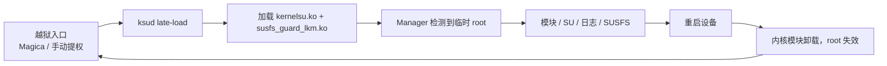

<div align="center">

# NekoSU

**KernelSU 临时 root（越狱模式）管理器，支持 GKI 5.x 与 4.x 传统内核**

[](https://github.com/laninenterline/NekoSU/releases)
[](https://github.com/laninenterline/NekoSU/actions)
[](LICENSE)
[](https://developer.android.com)

</div>

## 简介

NekoSU 是 KernelSU 的分支版本，包名 `com.nekosu`，**只提供临时 root（越狱模式）**：

- 不刷写 `boot` / `init_boot` / `vendor_boot`，不修改系统分区，不处理 AVB
- 通过越狱入口获得临时权限后，由 `ksud` 从用户态 `late-load` 内核模块
- **重启后 root 失效**，需要重新越狱并 late-load

支持 GKI 内核（5.4 – 6.18）以及 4.19 / 4.14 / 4.9 / 4.4 传统内核（实验性）。

> 与永久 root 的区别、越狱流程与限制，见 [临时 root 说明](docs/TEMPORARY-ROOT.md)。

## 工作原理



1. 设备先通过越狱入口（一键越狱 Magica 或手动提权）取得临时权限
2. `ksud` 检测 KMI，从 `userspace/ksud/bin/aarch64/` 选择对应预编译 ko 并加载
3. Manager 重启后通过 supercall 检测到 root，进入临时 root 会话
4. 重启后内核模块卸载，root 失效，回到未 root 状态

## 特性

| 特性 | 说明 |
|------|------|
| 临时 root / 越狱模式 | 一键越狱（Magica）、`ksud late-load`，不触碰 boot 分区 |
| KernelSU 兼容 | supercall、模块、App Profile、SELinux 处理 |
| SUSFS | 5.x 与 4.x 均提供 SUSFS LKM；4.x 由 CI 交叉编译 |
| 多管理器 | 可与其他 KernelSU 分支管理器共存并动态合并 |
| 统一日志中心 | SU / Magica / crash / metamodule / problem 日志聚合，搜索 / 导出 / 清除 |
| 包管理器观察 | 前台应用跟踪、应用图标网格布局、管理器图标选择 |
| 设置搜索 | 全量设置项可搜索 |
| WebUI（浏览器版） | 真正的 Web 前端服务：Material 3 风格的首页/模块/超级用户/日志/设置；设置内开关与随机端口 |
| 4.x 支持 | 4.19 / 4.14 / 4.9 / 4.4 预编译 LKM（实验性） |

## 内核支持

| 内核系列 | KMI | 状态 |
|---|---|---|
| 5.4 – 6.18 | android11-5.4 … android17-6.18（8 个 KMI） | 稳定 |
| 4.19 | android10-4.19 | 实验性 |
| 4.14 | android9-4.14 | 实验性 |
| 4.9 | android8-4.9 | 实验性 |
| 4.4 | android7-4.4 | 实验性 |

完整矩阵、KMI 识别逻辑与 4.x 移植细节见 [内核支持](docs/KERNELS.md)。

## 使用（临时 root / 越狱模式）

> **本项目只提供临时 root**：不刷写 boot 镜像、不做 boot patch、不提供永久 root 或永久卸载。
> 每次重启后需要重新越狱并 late-load 内核模块。

1. 从 [Releases](https://github.com/laninenterline/NekoSU/releases) 下载 APK 并安装
2. 通过越狱入口取得临时 root（一键越狱 Magica，或手动 `ksud late-load`）
3. 管理器检测到临时 root 后即可管理模块、SU、日志等

手动方式：

```bash
ksud late-load --allow-shell --package-name com.nekosu
```

> 需要 Android 8.0+；4.4 内核（Android 7）设备无法安装管理器，仅支持 `ksud` 手动模式。

## 构建

见 [构建指南](docs/BUILDING.md)。快速开始：

```bash
# ksud（需要 Rust nightly + Android NDK）
cargo +nightly build --target aarch64-linux-android --release \
  --manifest-path userspace/ksud/Cargo.toml

# Manager
cd manager && ./gradlew :app:assembleDebug
```

内核 LKM 由 CI 构建：

- GKI 5.x：`.github/workflows/build-lkm.yml`
- 4.x：`.github/workflows/build-4x-lkm.yml`

## 仓库结构

```text
kernel/            内核模块源码（core / feature / hook / policy / runtime / …）
kernel/susfs/      SUSFS LKM（vendored）
userspace/ksud/    Rust 守护进程（内嵌各 KMI 预编译 ko）
userspace/ksuinit/ ksuinit
manager/           Android 管理器（Compose / MVVM）
uapi/              内核、ksud、Manager 共享的 UAPI 头
scripts/           构建脚本（build_kmi.sh 等）
tools/             APK 重打包等工具
bindings/js/       JavaScript 绑定
docs/              架构 / 构建 / 内核 / 发布 / 临时 root / FAQ / 排障
```

## 文档

| 文档 | 内容 |
|------|------|
| [架构说明](docs/ARCHITECTURE.md) | 组件、启动链、KMI 选择、模块系统、安全模型 |
| [临时 root 说明](docs/TEMPORARY-ROOT.md) | 越狱模式定义、late-load 参数、与永久 root 对比 |
| [构建指南](docs/BUILDING.md) | ksud / Manager / 5.x / 4.x LKM 构建 |
| [内核支持](docs/KERNELS.md) | KMI 矩阵、4.x 移植与限制 |
| [发布流程](docs/RELEASING.md) | 版本号、签名、Tag 与 Release |
| [常见问题](docs/FAQ.md) | 安装、越狱、KMI、4.x |
| [故障排查](docs/TROUBLESHOOTING.md) | 日志位置、常见错误、Issue 模板 |

## 参与贡献

见 [CONTRIBUTING.md](CONTRIBUTING.md)。提交前请确认不引入永久 root / boot patch 相关功能或文案。

## 致谢

- [KernelSU](https://github.com/tiann/KernelSU)
- [SUSFS4KSU](https://github.com/simonpunk/susfs4ksu)
- 所有上游贡献者

## 免责声明

本项目按 GPL-2.0 分发，不提供任何担保。临时 root / 越狱可能触发设备安全机制，
请自行评估风险；因使用本软件造成的设备损坏、数据丢失或保修问题由用户自行承担。

## 许可证

[GPL-2.0](LICENSE)
