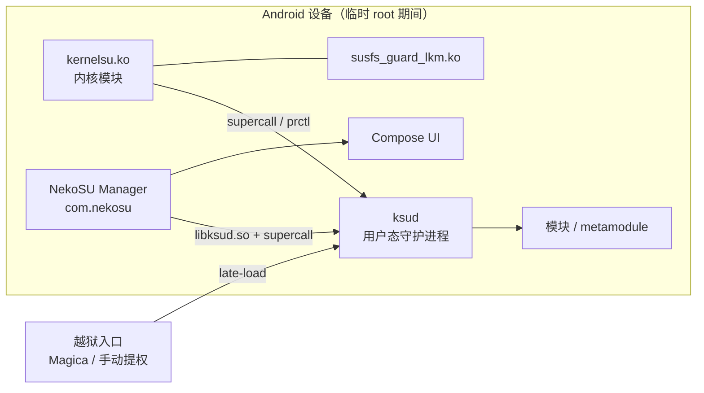
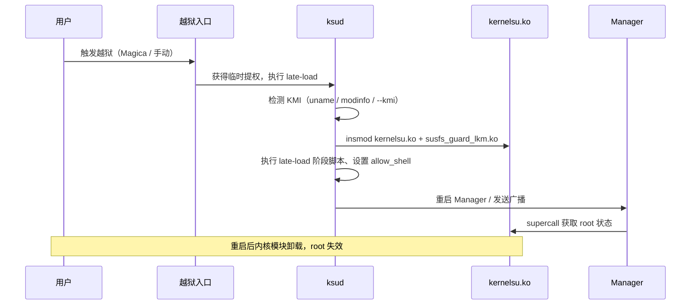

# 架构说明

## 1. 设计目标

- 基于 KernelSU 内核模块提供内核级 root，兼容 GKI 5.4 – 6.18 与 4.x 传统内核
- **临时 root（越狱模式）only**：不修改 boot / system / vendor 分区，不处理 AVB
- 模块化：内核模块、`ksud`、Manager 三层解耦，均通过 UAPI 通信
- 多 KMI：同一套源码产出 8 个 GKI KMI + 4 个 4.x KMI 的 LKM

## 2. 组件总览



| 组件 | 目录 | 职责 |
|------|------|------|
| 内核模块 | `kernel/` | supercall 分发、allowlist、App Profile、SELinux 处理、sulog |
| SUSFS LKM | `kernel/susfs/` | 路径/进程隐藏、kstat 伪装、挂载隐藏、open redirect |
| ksud | `userspace/ksud/` | late-load、模块管理、安装/卸载、事件脚本、日志读取 |
| ksuinit | `userspace/ksuinit/` | 早期启动阶段初始化 |
| Manager | `manager/` | Compose UI、模块/SU/日志管理、越狱入口 |
| UAPI | `uapi/` | 内核 / ksud / Manager 共享 ABI 定义 |

## 3. 启动与临时 root 生命周期



关键点：

- `late-load` 由用户态触发，因此**没有 boot 镜像集成**，也不依赖 init 阶段
- `--allow-shell` 决定是否允许 adb shell 直接使用 root；越狱场景常用
- `--kmi` 可强制指定 KMI；不指定时按 `uname -r` → `/vendor/lib/modules` modinfo → 回退顺序识别
- 进程在模块加载后由 `ksud` 重启 Manager，使其能通过 supercall 检测到 root

## 4. 内核模块

```text
kernel/
├── core/       模块入口、初始化、feature 注册
├── feature/    动态管理器、模块黑名单等
├── hook/       syscall/kprobe/tracepoint hook 基础设施
├── manager/    包观察、throne 跟踪
├── policy/     allowlist、app profile、seccomp
├── preinit/    preinit 阶段
├── runtime/    ksud 集成、su 路径
├── selinux/    SELinux 策略与 sid 处理
├── sulog/      root 操作日志
├── supercall/  supercall 命令分发
├── susfs/      SUSFS LKM（vendored）
└── compat/     跨内核版本兼容层
```

模块特性开关由 Kconfig 控制；构建时按 KMI 选择 `Kbuild`/`Makefile` 组合。

## 5. ksud

`ksud` 是 Rust 编写的单一二进制，主要子命令：

| 命令 | 说明 |
|------|------|
| `late-load` | 加载 `kernelsu.ko` + SUSFS LKM，执行 late-load 脚本 |
| `module install/uninstall/list` | 模块管理 |
| `post-fs-data` / `services` / `boot-completed` | 触发模块生命周期脚本 |
| `su` | 进入 root shell |
| `insmod` | 带 kallsyms 访问的模块加载 |
| `boot-patch` / `boot-restore` | 上游 GKI 安装能力（本项目发布流程不使用） |
| `debug` | 诊断子命令（sulogd、KMI 等） |

`userspace/ksud/bin/aarch64/` 保存所有 KMI 的预编译 ko；`libksud.so` 由 Manager 打包，
`ksud` 在 late-load 时按 KMI 选择对应文件。

## 6. Manager

`manager/app/src/main/java/com/nekosu/`：

- `data/`：仓库层（ksuCli、模块、日志、设置、动态管理器）
- `domain/`：用例与模型
- `ui/`：Compose 页面、导航、组件
- `di/`：依赖注入
- `magica/`：一键越狱兼容与失败日志

关键页面：主页（越狱/状态）、模块、超级用户、日志中心、设置（含设置搜索）、
Umount 管理、KMI 诊断、应用图标、关于。

## 7. KMI 选择

1. `ksud` 读取 `uname -r`，GKI 内核从 release 字符串解析 `androidNN-x.y`
2. 失败时读取 `/vendor/lib/modules/*.ko` 的 `vermagic`
3. 4.x 内核无 GKI tag，按版本回退：
   `4.19 → android10-4.19`、`4.14 → android9-4.14`、`4.9 → android8-4.9`、`4.4 → android7-4.4`
4. Manager 端 `KmiMatcher` 使用同一套映射展示当前 KMI

## 8. 模块系统

- 模块为 ZIP，安装到 `/data/adb/modules/<id>`
- 支持 metamodule（挂载/overlay 依赖，影响全部模块）
- 生命周期脚本：`post-fs-data.sh`、`service.sh`、`boot-completed.sh` 等由 ksud 触发
- 模块刷写由 `FlashRepository` 处理；**不提供内核/boot 安装与永久卸载**

## 9. 日志中心

统一聚合：

- `sulog`（root 操作）
- Magica / 越狱失败日志
- crash / problem 日志
- metamodule 日志

支持搜索、导出、清除，以及 bugreport 保存/分享。

## 10. 安全模型

- 内核模块只在临时 root 期间存在，重启即卸载
- `allow_shell` 控制 adb shell 的 root 权限
- App Profile 支持按包名限制 root、SELinux 域、seccomp
- 越狱失败会记录专用失败日志；部分 OEM 越狱重启后自动禁用一键越狱，避免重启循环
- 发布 APK 使用固定 release keystore（证书 SHA-256 见 [RELEASING](RELEASING.md)）
