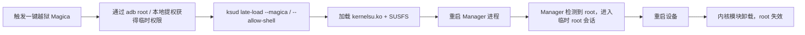

# 临时 root（越狱模式）

## 1. 定义

NekoSU 的 root 是**临时的**：`kernelsu.ko` 由 `ksud` 在系统启动后从用户态
`late-load` 加载进当前内核，配合 `susfs_guard_lkm.ko` 提供隐藏能力。

| 维度 | 临时 root（本项目） | 永久 root（本项目不支持） |
|------|------------------|------------------------|
| 修改 boot / init_boot / vendor_boot | ❌ | ✅ |
| 修改系统分区 / AVB | ❌ | 视方案 |
| 获得 root 的方式 | 越狱提权 + `ksud late-load` | 刷入 patch 后的 boot 镜像 |
| 重启后 | root 失效，需要重新越狱 | 自动获得 root |
| 永久卸载 | 不需要（重启即恢复） | 需要恢复原厂 boot |
| 风险 | 低（不碰启动链） | 较高（刷写/变砖风险） |

## 2. 越狱模式（jailbreak）



一键越狱（Magica）细节：

- 通过 adb root 修改属性并重启 adbd，使 `ksud late-load` 能以足够权限执行
- 部分 OEM ROM 修改 adbd 属性会触发重启：管理器有**重启保护**，重启后自动禁用一键越狱
- 失败会写入专用失败日志（日志中心 → jailbreak 分类）
- 手动方式：先自行取得临时 root，再执行
  `ksud late-load --allow-shell --package-name com.nekosu`

## 3. late-load 参数

```bash
ksud late-load [OPTIONS]

Options:
  --magica [PORT]        用 adb root 执行越狱（默认 5555）
  --allow-shell          加载时传 allow_shell=1，允许 adb shell root
  --post-magica          越狱后恢复 adb 属性
  --kmi <KMI>            强制指定 KMI（否则自动检测）
  --package-name <NAME>  管理器包名，默认 com.nekosu
```

## 4. 常见问题

**Q：为什么每次重启都要重新越狱？**
A：因为不刷 boot、不修改启动链，内核模块只存在于当前内核生命周期。

**Q：重启后管理器显示未安装？**
A：这是临时 root 的正常状态；重新越狱即可。

**Q：能变成永久 root 吗？**
A：当前版本不提供；需要单独的 boot patch + AVB 处理 + 永久卸载流程，属于未来工作。

**Q：越狱失败/重启循环？**
A：查看日志中心的 jailbreak 失败日志；一键越狱的重启保护会自动禁用，之后可用手动 late-load。

## 5. 安全与风险

- 不修改启动链，理论上不会因本方案变砖
- `--allow-shell` 会扩大 adb 侧 root 暴露面，按需开启
- 越狱提权本身可能依赖 OEM 漏洞，失败/重启风险由越狱入口承担
- 所有 root 操作可被 `sulog` 记录，便于审计
